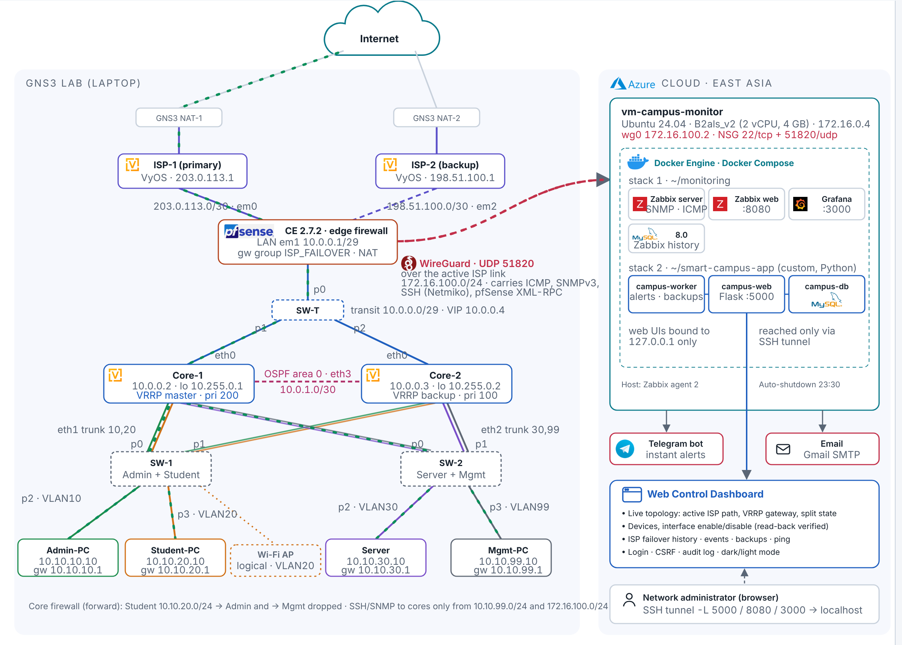
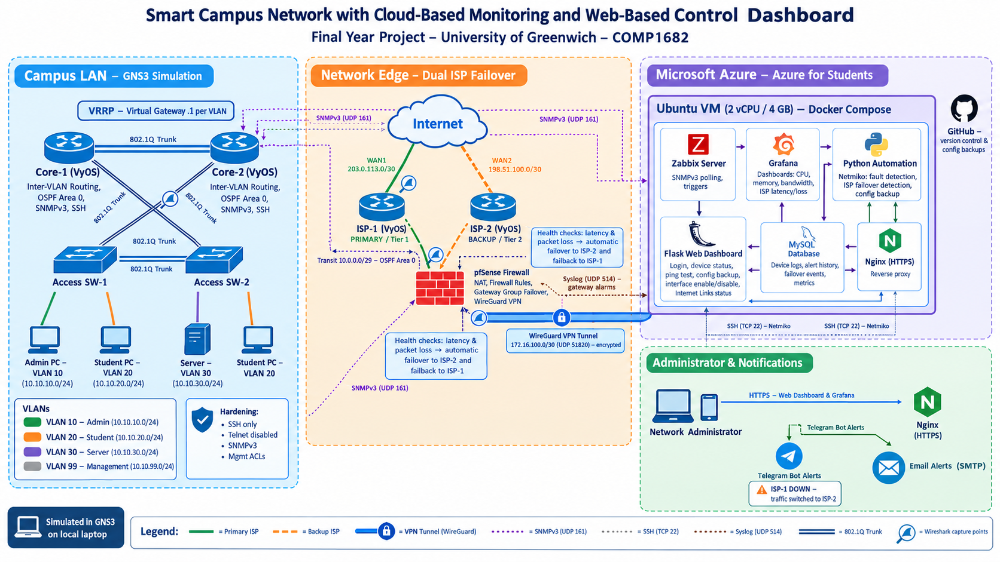
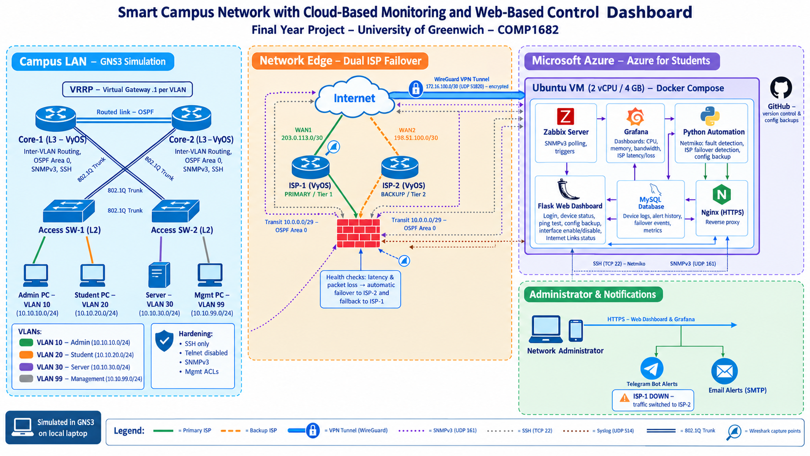

# Smart Campus Network with Cloud-Based Monitoring and Web-Based Control Dashboard

**COMP1682 Final Year Project · University of Greenwich**

**Author:** Kokila Dissanayaka (001565530) · **Supervisor:** Mr. Nalaka Dissanayaka

A resilient campus network built in GNS3, monitored from Microsoft Azure over an encrypted
WireGuard tunnel, with a custom web dashboard that detects faults in seconds, alerts staff on
Telegram and email, and lets an administrator manage the routers safely.



---

## Key results

| Metric | Result |
|---|---|
| Host failure detected and alerted | **8 s** (target < 60 s) |
| Detection vs Zabbix default ICMP check | **4 s vs 147 s** (~35× faster) |
| ISP failover (user outage) | **~10 s**, failback with **0 packet loss** |
| VRRP gateway failover | **~1 s**, **0 packet loss** (932/932 pings) |
| Dashboard response time | **12–14 ms** (server side) |
| Cloud VM load (whole monitoring stack) | ~40 % RAM, ~6 % CPU on a B2als_v2 VM |

---

## Architecture

| Layer | Components |
|---|---|
| Internet / ISP | ISP-1 (primary) and ISP-2 (backup), VyOS, NAT to the internet |
| Edge | pfSense CE 2.7.2: firewall, NAT, gateway group `ISP_FAILOVER` (Tier 1/2), WireGuard |
| Core | Core-1 / Core-2 (VyOS): inter-VLAN routing, **VRRP** (priority 200/100), **OSPF** area 0 |
| Access | SW-T (transit), SW-1 (VLAN 10, 20), SW-2 (VLAN 30, 99): 802.1Q trunks + access ports |
| Cloud | Azure Ubuntu 24.04 VM: Zabbix 7.0, Grafana 11.6, MySQL, **smart-campus-app** (Docker) |

### VLANs

| VLAN | Name | Subnet | Gateway (VRRP VIP) |
|---|---|---|---|
| 10 | Admin | 10.10.10.0/24 | 10.10.10.1 |
| 20 | Student | 10.10.20.0/24 | 10.10.20.1 |
| 30 | Server | 10.10.30.0/24 | 10.10.30.1 |
| 99 | Management | 10.10.99.0/24 | 10.10.99.1 |
| — | Transit (pfSense ↔ cores) | 10.0.0.0/29 | 10.0.0.4 |





---

## Features

**Network**
- Redundant gateways with VRRP (RFC 3768 virtual MAC) and OSPF between the cores
- Dual-ISP automatic failover and failback on pfSense
- Firewall policy: Student → Admin and Student → Management blocked
- Hardening: named admin account only (default account removed), SSH and SNMP allowed only from management networks, login banner

**Monitoring (Azure)**
- WireGuard site-to-cloud tunnel; nothing exposed to the internet except WireGuard and SSH
- Zabbix with SNMPv3 (authPriv, SHA/AES) and ICMP; Grafana dashboards
- Telegram + email alerts

**smart-campus-app (custom, this repository)**
- `campus-worker`: pings every device every 10 s (DOWN after 2 failures), reads pfSense gateway status (XML-RPC), reads VRRP and interface state of both cores (SSH), dependency-aware alerting (one *SITE UNREACHABLE* alert instead of an alert storm), scheduled configuration backups with retry and retention
- `campus-web`: Flask dashboard with live topology map (active ISP path, active VRRP gateway, split state), devices, interface control with read-back verification, ISP failover history, events, backups, audit log, dark/light mode
- Security: login with hashed passwords, CSRF protection on every action, audit log of every change, reachable only through an SSH tunnel

---

## Repository layout

```
smart-campus-app/          Custom automation + dashboard (Docker)
  app/worker.py            Background service (detection, alerts, backups)
  app/web.py               Flask web dashboard
  app/common/              Config, DB, notifications, router + pfSense access, backups
  app/templates/           Dashboard pages
  docker-compose.yml       campus-db, campus-worker, campus-web
  .env.example             Settings template (copy to .env; never commit .env)
network-configs/
  core1-vyos.conf          Core-1 configuration (secrets removed)
docs/
  COMMANDS.md              Operations command reference (VM, Docker, cores, ISPs, pfSense, VPCS)
  topology.png             Full topology diagram
  screenshots/             Test evidence
```

---

## Running the dashboard

Requirements: Docker + Docker Compose on the monitoring VM, and a route to the campus
(WireGuard tunnel).

```bash
cd smart-campus-app
cp .env.example .env && nano .env      # fill in your own passwords and tokens
docker compose up -d --build
docker compose exec campus-worker python selftest.py
```

The dashboard listens on `127.0.0.1:5000` only. Open it through an SSH tunnel:

```bash
ssh -i <key>.pem -L 5000:127.0.0.1:5000 -L 8080:127.0.0.1:8080 -L 3000:127.0.0.1:3000 azureuser@<vm-ip>
```

Then browse to http://localhost:5000 (Zabbix: :8080, Grafana: :3000).

More commands for every device: [docs/COMMANDS.md](docs/COMMANDS.md).

---

## Testing summary

| Test | What was done | Result |
|---|---|---|
| A. Device failure | Student-PC stopped | DOWN alert in 8 s, RECOVERED in 7 s |
| B. ISP failover | ISP-1 uplink suspended | ~10 s outage, failback 0 loss |
| C. Config backup | Backup from dashboard | Core 13 s (SSH), pfSense 3 s (XML-RPC) |
| D. Interface control + VRRP | eth1.10 disabled/enabled on Core-1 | Gateway moved in ~1 s, 0 loss, audited |
| Worker vs Zabbix | ISP-2 stopped | 4 s vs 147 s |
| Wireshark | WAN and LAN captures | WireGuard payload encrypted; SNMPv3 `encryptedPDU` |

Problems found during testing and fixed: CSRF token missing in a dialog form, VyOS
bracketed-paste escape codes breaking SSH automation, an interrupted commit leaving a router
inconsistent (now verified by read-back), stuck failover records, start-up backups failing
before the lab was online (now retried), and an alert storm during an upstream outage
(now dependency-aware).

---

## Limitations and future work

- GNS3 on a 12 GB laptop: under heavy host load the emulated routers were CPU-starved
- Both emulated ISPs share the laptop's single internet uplink
- GNS3 built-in switches have no management plane, so switch ports are drawn from static configuration
- Future work: managed switches with SNMP/LLDP port discovery, wireless AP monitoring, HTTPS reverse proxy with MFA

---

## Security note

No real passwords, keys or tokens are stored in this repository. `.env` is excluded by
`.gitignore`; router configuration exports have password hashes and SNMP keys removed.

Product logos shown in the diagrams are trademarks of their respective owners.
